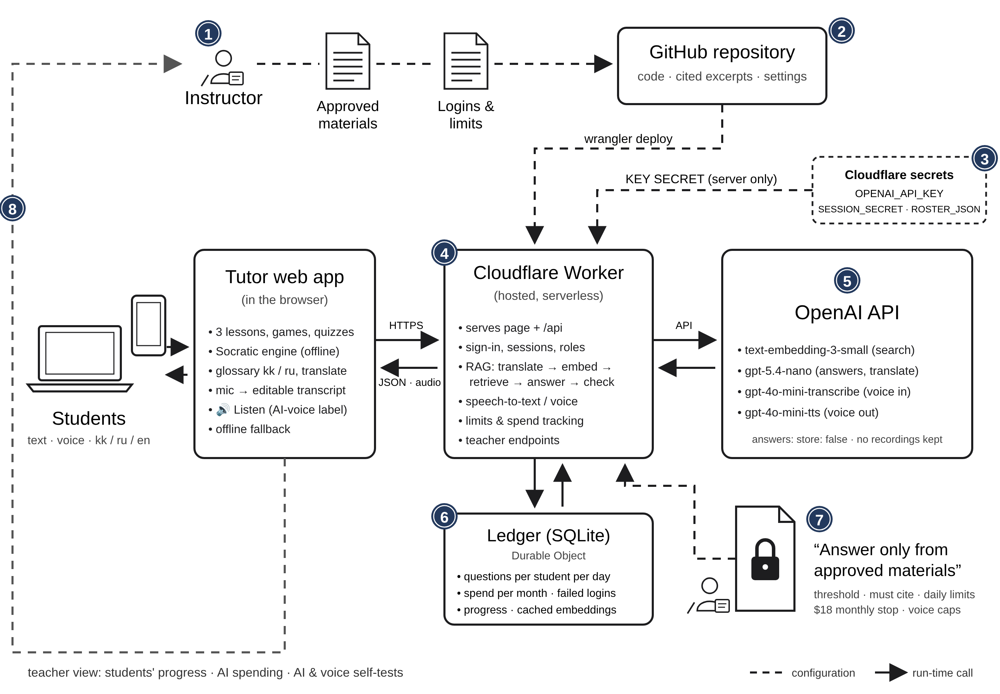

# System architecture

**Fig. 1** Architecture of the Senim Space Terms tutor (7th grade, CKLA Grade 3 Unit 7 "What's in Our Universe?").
Dashed arrows are configuration done before or between lessons. Solid arrows are run-time requests.
The layout follows Fig. 1 of the OS315 paper (Instructor → Assistant → Flowise → GitHub Pages → Students),
with each part replaced by the one Senim uses.

1. **Instructor.** Chooses the approved materials (Reader Ch. 1–3, Teacher Guide vocabulary, Anthology glossary,
   listed in `server/materials/approved.json`) and sets logins and limits (`npm run roster`, `wrangler.toml [vars]`).
   The lessons, Socratic questions and kk/ru glossary are written into the page.
2. **GitHub repository.** Holds the code, the cited excerpts (`server/src/chunks.json`) and the settings.
   `npm run deploy` (wrangler) publishes them to Cloudflare.
3. **Secrets.** `OPENAI_API_KEY`, `SESSION_SECRET` and `ROSTER_JSON` (hashed sign-in codes) are Cloudflare Worker
   secrets. They are never in the repository or the browser.
4. **Cloudflare Worker** (the paper's Flowise). Serves the tutor page and `/api`: sign-in and 8-hour sessions,
   the RAG pipeline (translate kk/ru → embed → retrieve the top 4 excerpts → answer → check citations),
   speech-to-text and AI voice, limits and spending, and the teacher endpoints.
5. **OpenAI API** (the paper's Assistant). `text-embedding-3-small` for search, `gpt-5.4-nano` for answers and
   translation, `gpt-4o-mini-transcribe` for voice questions, `gpt-4o-mini-tts` for spoken answers. Answer requests use
   `store: false`, and recordings are never kept.
6. **Ledger** (Durable Object, SQLite). Questions per student per day, spending per month, failed sign-ins,
   lesson progress and the cached embeddings index. It never stores questions, answers or audio.
7. **"Stay on topic" policy.** The model only sees retrieved excerpts. Questions below the similarity threshold are
   declined without calling the model, answers must cite excerpts they were given, and daily limits, voice caps and
   the $18 monthly stop apply.
8. **Feedback to the instructor.** The teacher's view shows each student's progress bar, stars, XP and words learned,
   the AI spending, and the AI and voice self-tests.

**Students** use the tutor web app in a browser on a laptop or phone, by text or voice, in English with
Kazakh/Russian help. Lessons, games and the Socratic engine run in the browser and keep working offline when
the AI is unavailable.

## Differences from the paper's design

| Paper (OS315) | Senim |
|---|---|
| OpenAI Assistant set up in the web interface | Plain API calls with a fixed prompt, kept in the repository |
| Flowise AI (hosted) holds the key | Cloudflare Worker holds the key as a secret |
| "Stay on topic" prompt policy | Retrieval threshold, required citations checked by the server, limits and budget |
| HTML/JS widget on GitHub Pages | Page served by the same Worker, with an offline tutor |
| Feedback from students to the instructor | Teacher view with progress bars, spending and self-tests |

A paper-style write-up grounded in Berengueres (2025), with design rationale and an evaluation plan, is in [system-architecture.md](system-architecture.md).

Source: `architecture.svg` (edit it, then export the PNG at 2× from a browser).
